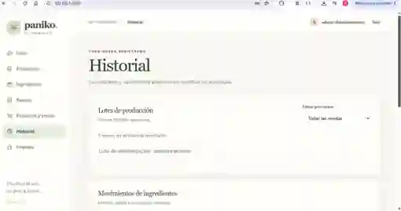

# Paniko 🍞
**Sistema para organizar el inventario, las recetas y la producción de una panadería**

Proyecto de **Seminario de Integración: Desarrollo**  
Ingeniería Informática · Universidad de Guadalajara, CU Tlaquepaque

**Versión actual en `main`: 0.7.2**

## ¿Qué es Paniko?

Paniko es el proyecto que estamos desarrollando para facilitar el trabajo en una panadería artesanal. La idea surgió de la necesidad de tener mejor organizados los ingredientes, las recetas y todo lo que se utiliza al preparar el pan.

Quiero que sea una herramienta práctica, no un sistema complicado de llenar. Por eso estamos trabajando para que se puedan consultar las existencias, crear fichas técnicas, calcular cantidades para distintas producciones y llevar un historial de los movimientos sin tener que hacerlo todo a mano.

El proyecto todavía está en desarrollo. Ya tenemos varias funciones implementadas, pero hay otras que seguimos probando y mejorando.

## ¿Qué se puede hacer actualmente?

| Sección | ¿Para qué sirve? |
| --- | --- |
| **Inicio** | Consultar un resumen de la panadería y entrar a las funciones principales. |
| **Ingredientes** | Registrar insumos, consultar existencias y hacer entradas, salidas o ajustes. |
| **Recetas** | Consultar recetas, crear fichas técnicas y escalar ingredientes según las piezas que se necesitan. |
| **Producción** | Calcular lo necesario para una tanda y descontar ingredientes cuando se confirma. |
| **Productos y ventas** | Registrar productos terminados, controlar piezas disponibles y registrar ventas y otros movimientos. |
| **Historial** | Revisar producciones y movimientos anteriores. |
| **Finanzas** | Consultar costos y gestionar precios. Esta sección está reservada para administración. |

También implementamos inicio de sesión y dos tipos de usuario. Las personas que trabajan en la panadería pueden consultar las recetas dentro del sistema, pero **solo administración puede acceder a la información financiera**.

### Conversión de unidades y porcentaje panadero

Una parte importante del proyecto es que las recetas no siempre están escritas con las mismas unidades que el inventario.

En la versión **0.7.2** trabajamos en estas equivalencias:

- **Gramos y kilogramos:** 1000 g = 1 kg.
- **Mililitros y litros:** 1000 ml = 1 l.
- **Agua:** usamos la aproximación culinaria de 1 g ≈ 1 ml.
- **Huevo:** tomamos como referencia 1 pieza = 50 g sin cáscara.
- **Porcentaje panadero:** la cantidad total de harinas representa el 100 % y, a partir de ella, se calculan los porcentajes de los demás ingredientes.

Estas equivalencias no se aplican de manera general a cualquier ingrediente. Por ejemplo, no podemos asumir que el aceite y el agua pesan lo mismo por litro. La parte de conversiones ya tiene pruebas en el código, pero todavía queremos revisar los formularios con el uso real de la panadería.

## Cómo fue la prueba con Ale

Del **4 al 7 de noviembre de 2026** le compartí a **Ale Sánchez**, encargada de la panadería, la versión **0.4** de Paniko. La utilizó durante **tres días** dentro de ese periodo.

En general me comentó que sí le ayudó para trabajar, pero también me hizo varias observaciones que nos sirvieron para seguir mejorándolo.

1. **La pantalla era confusa.** Había demasiada información junta, así que después reorganizamos la aplicación por secciones.
2. **Tuvo problemas al crear fichas técnicas.** No reconocía correctamente que un ingrediente registrado en gramos podía utilizarse en kilogramos, o al revés.
3. **Le gustaría ver cómo le fue en la semana.** Nos pidió un espacio para revisar cuánto vendió, ganó, invirtió y perdió.

Esa prueba fue importante porque pudimos conocer la opinión de alguien que realmente trabaja en una panadería. **Ale probó la versión 0.4**, así que no vamos a presentar sus comentarios como una aprobación de la versión 0.7.2.

Dejamos la información más detallada aquí:

- [Prueba y comentarios de Ale](docs/seguimiento/evaluacion-usuaria-ale-v04.md)
- [Lo que aprendimos y qué vamos a mejorar](docs/seguimiento/retrospectiva-medio-termino.md)

## Capturas de Paniko

Estas capturas corresponden a la interfaz que utilizamos durante las pruebas locales de la versión 0.7.1. Ocultamos los datos de operaciones y no publicamos cantidades de recetas reales.

**Pantalla de inicio**


**Historial de producción**



En una prueba local también apareció el error **«La unidad de Agua no coincide con la registrada en Ingredientes»** al intentar crear una ficha. El agua estaba registrada en litros y la receta la utilizaba en gramos. Este caso está registrado en el [Issue #12](https://github.com/paulinalizette70-boop/Paniko/issues/12). La versión 0.7.2 incluye un cambio para tratar esa equivalencia, pero falta comprobarlo en nuestra instalación.

No subimos la captura original de esa receta porque contiene información privada de la panadería.

## Tecnologías que usamos

- **HTML, CSS y JavaScript** para las pantallas.
- **Node.js** para el servidor y la API.
- **MySQL** para guardar ingredientes, recetas, movimientos y demás registros.
- **Git y GitHub** para llevar el control de los cambios.
- **GitHub Actions** y las pruebas de Node.js para comprobar que los cambios no rompan otras funciones.

El código está organizado principalmente en `public/` (pantallas), `src/` (funciones del sistema), `sql/` (base de datos), `tests/` (pruebas), `scripts/` (configuración) y `docs/` (documentación).

## Cómo ejecutar el proyecto

Para trabajar con Paniko necesitamos **Node.js 20 o superior** (preferentemente 22), **MySQL 8** y un navegador.

**1. Descargar el proyecto y sus dependencias**

Desde PowerShell:

```powershell
git clone https://github.com/paulinalizette70-boop/Paniko.git
cd Paniko
npm.cmd install
```

**2. Configurar la conexión a MySQL**

Copia `.env.example` a un archivo llamado `.env` y escribe ahí los datos de tu conexión. Ese archivo **no se debe subir a GitHub**.

```powershell
Copy-Item .env.example .env
# Editar .env con los datos de la base de datos
node --env-file=.env scripts/init-db.js
```

Si ya tienes una base de datos con información, haz una copia de seguridad antes de aplicar cambios.

**3. Crear el primer usuario administrador**

```powershell
node --env-file=.env scripts/create-admin.js
```

El programa solicitará una contraseña. Se hace desde una terminal interactiva.

**4. Iniciar Paniko**

```powershell
node --env-file=.env server.js
```

Después abre **http://127.0.0.1:3000**.

> Si ya tienes Paniko instalado con recetas o movimientos reales, no reemplaces toda la carpeta ni la base de datos sin hacer un respaldo. Para instalaciones que vienen de la 0.6.0 también tenemos una [nota de corrección de inventario](docs/releases/Paniko-0.7.1-correccion-inventario.md).

## Cómo usamos las pruebas

Agregamos pruebas para revisar los cálculos, las conversiones de unidades, las fichas técnicas, el inventario, los productos, el inicio de sesión y algunas operaciones con MySQL.

Para ejecutarlas:

```powershell
npm.cmd test
```

Las pruebas que utilizan MySQL se hacen con una base independiente que termina en `_test`, para no modificar información de la panadería.

**Evidencias que podemos mostrar:**

- [Pruebas aprobadas al integrar la versión 0.7.2 a `main`](https://github.com/paulinalizette70-boop/Paniko/actions/runs/43368734526).
- [Casos de prueba](docs/pruebas/casos-de-prueba.md).
- [Registro de ejecuciones](docs/pruebas/registro-ejecuciones.md).
- [Pull Request #9, donde integramos las mejoras](https://github.com/paulinalizette70-boop/Paniko/pull/9).

Que las pruebas automáticas salgan bien es una buena señal, pero todavía necesitamos verificar que todo se pueda utilizar correctamente desde las pantallas y con la instalación local.

## ¿Qué nos falta?

Estas son las siguientes cosas que queremos trabajar:

| Pendiente | Seguimiento |
| --- | --- |
| Revisar de principio a fin la creación de fichas con gramos y kilogramos. | [Issue #11](https://github.com/paulinalizette70-boop/Paniko/issues/11) |
| Probar en nuestra instalación la conversión de agua entre gramos y litros. | [Issue #12](https://github.com/paulinalizette70-boop/Paniko/issues/12) |
| Hacer el resumen financiero semanal que nos pidió Ale. | [Issue #10](https://github.com/paulinalizette70-boop/Paniko/issues/10) |
| Volver a mostrarle la nueva interfaz a Ale y anotar sus observaciones. | [Evaluación](docs/seguimiento/evaluacion-usuaria-ale-v04.md) |
| Completar las evidencias individuales y revisar los PRs antiguos que siguen abiertos. | [Entrega en GitHub](docs/entrega-github.md) |

## Integrantes del equipo

- **Paulina Lizette Villalpando Guizar**
- **Saúl Emiliano Mora Famoso**
- **Gael Iosef Ramírez Marmolejo**

Este es un proyecto que seguimos desarrollando en equipo. En los commits, Issues y Pull Requests vamos registrando los cambios y las tareas para que se pueda revisar el avance de cada integrante.

## Cómo organizamos los cambios en GitHub

Tratamos de no hacer todos los cambios directamente en `main`. Primero se trabajan en otra rama, se prueban y después se integran mediante un Pull Request.

La versión **0.7.2 ya se integró a `main` con el [PR #9](https://github.com/paulinalizette70-boop/Paniko/pull/9)**. Las pruebas automáticas de esa integración terminaron correctamente. Nos falta documentar una revisión formal del código por otro integrante; no queremos marcarla como realizada si todavía no tenemos esa evidencia.

También guardamos las [decisiones de arquitectura](docs/adr/), los [bloqueos](docs/seguimiento/bloqueos.md) y la [deuda técnica](docs/seguimiento/deuda-tecnica.md) para recordar por qué hicimos ciertos cambios y qué falta resolver.

## Sobre las recetas y los datos privados

El repositorio es público porque lo utilizamos para el proyecto académico, **pero las recetas reales de la panadería no lo son**.

Por eso no subimos nuestras fórmulas, contraseñas, archivos `.env`, la carpeta `private/`, respaldos de MySQL ni capturas con datos sensibles. Las personas autorizadas pueden consultar las recetas dentro de Paniko, pero eso no significa que sus cantidades deban quedar publicadas en GitHub.

Por ahora el código tiene la configuración de licencia `UNLICENSED`; todavía no hemos definido una licencia de distribución con el equipo.

---

*Paniko sigue en desarrollo. Queremos que cada versión sea más útil, más clara y más fácil de usar en el trabajo diario de la panadería.*
